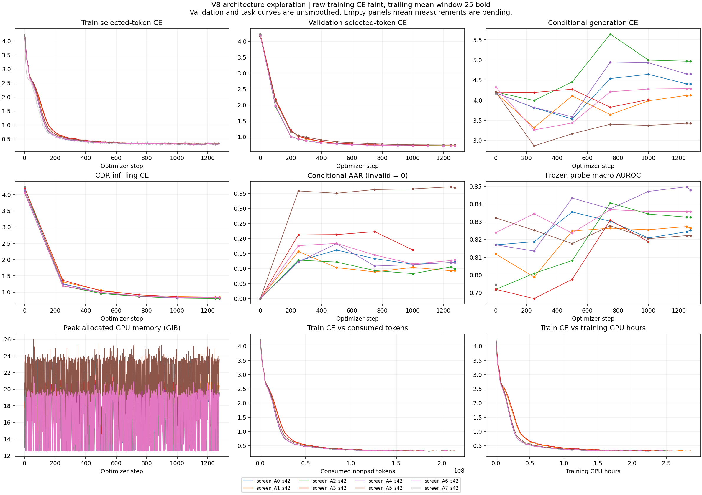

# V8 约 70M 架构探索实验记录

2026-10-28，执行用户批准的计划。工作树 `/mnt/project-storage/fset-rN4kfh/251105016/dllm_arch_explore`，分支 `explore/arch70m-v8-20261028`。当前 1B 训练使用的工作树、冻结源码和输出未改动。

## 问题与固定预算

比较架构是否改善固定解码的生成质量、冻结特征的表征质量。两项目标同等重要；更低 MLM loss 不能单独支持“生成更好”的结论。

基础模型从当前正式 V8 冻结源码导入，来源与逐文件 SHA 见 `/mnt/project-storage/fset-rN4kfh/251105016/dllm_arch_explore/experiments/arch70m/baseline_sources.json`。原来的 RMSNorm、SwiGLU、RoPE、双向全头注意力、交替链局部/全局可见性、0.1 残差缩放、V-family 辅助目标均保留作为 A0。尺寸缩至 8 层、768 维、12 头、FFN 3072，实际 **75,741,903** 参数。所有模型从头训练，同种子下形状相同的原有参数使用相同初值；A6 因 FFN 尺寸改变而单独初始化这些层。

固定：10% 数据，global batch 512，AdamW LR 1e-4、betas (0.9,0.999)、epsilon 1e-8、weight decay .01、梯度裁剪 1，前 5% 步 warmup 后 cosine，BF16、关闭 TF32、PyTorch 确定性算法、整层 activation checkpointing。原 V8 token/family 目标、167/135 链槽位、最大序列 2048、183 类 family 词表均不变。micro 先倍增再按 8 条粒度细化，reserved+外部占用不超过总显存 85%；不整除 512 时最后一个 micro 缩短，仍恰好 512 条。损失按整个有效 batch 的有效 token/chain 数归一化。profile 后重新初始化模型和优化器。

## 架构矩阵与来源

| ID | 相对 A0 的唯一改动 | 参数数 | 目的 |
|---|---|---:|---|
| A0 | 原版 V8，缩至上述尺寸 | 75,741,903 | 对照 |
| A1 | RoPE 前 Q/K 每头 RMSNorm | 75,742,927 | 检验 attention logit 稳定性 |
| A2 | SDPA 后、输出投影前，可学习 sigmoid 每头门控 | 75,815,727 | 检验输入相关门控 |
| A3 | A1 + A2 | 75,816,751 | 检验组合效果 |
| A4 | 固定残差缩放改为可学习向量，初值仍 .1 | 75,754,191 | 检验分层更新尺度 |
| A5 | 各层均全局可见 | 75,741,903 | 检验局部/全局交替设计 |
| A6 | 逐层 FFN 宽度 4608/4464/4032/3408/2736/2112/1680/1536 | 75,741,903 | 固定 FFN 总参数量下的层间分配 |
| A7 | SDPA 输出固定乘 .5 | 75,741,903 | 排除 A2 仅因平均幅度减小而受益 |

QK norm 参考 [Qwen3 技术报告](https://arxiv.org/html/2505.09388v1)；门控位置参考 [Gated Attention](https://arxiv.org/abs/2505.06708)；A6 参考 [Tapered Language Models](https://arxiv.org/abs/2606.23670) 的宽度重分配思想，按本模型 FFN 预算离散化。这些是实验动机，未预设它们对免疫序列有效。[recAMPLIFY](https://arxiv.org/abs/2610.26747) 的循环计算与 [mHC](https://arxiv.org/abs/2512.24880) 留待后续，因为本轮优先保持计算/参数比较清楚。

## 数据与防泄漏边界

**2026-10-28 用户确认：所有架构探索保持当前数据形式。** 沿用 V8 prepared JSONL 的字段、链序列与顺序、chain roles/metadata、relation/family 标签，以及现有 tokenizer、词表、特殊 token 和固定链输入布局；复用冻结的 reader/collator。10% 抽样只选择原记录 offsets。独立实验索引与评估记账信息不改变训练记录 schema，不为架构变体新增或转换输入格式。已核对 109 个训练分片的路径与内容 SHA 均与父索引相同；本次仅补充约束，正在运行的实验无需变动。

原数据只读：`/mnt/project-storage/fset-rN4kfh/251105016/dllm_test/data/prepared/immune_v8_four_relations_20261026_r2`。使用当前验证过的父 index，每个训练分片内按 relation、receptor signature 分层，以确定性 hash 选约十分之一，最小分层至少 1 条。不是“只读开头 10%”。训练索引、验证样本和全部输入 SHA 固定在探索 output 的 `data/index.json`。

先排除所有原 valid 和 protected probe_valid 的 observed receptor identity，再排除 AB specificity 全部 4398 个样本的完整链及已审计 Fv 对。identity 包含角色和真实观测序列，去掉 synthetic residues，涵盖 VHH。保护的是精确受体组合，**不声称同源性、单链或结构簇完全隔离**。原 probe_train 只用于拟合冻结特征头，不加入额外预训练步骤。

valid/probe_valid 依据同一个受体 hash 固定分为 screen / confirm，避免相同受体跨两边。screen 每来源最多 64 条 token 验证、16 条 task 候选；confirm 分别 128/64 条。task 再排除非结合、合成链、空链；CDR 只接受 FR/CDR 注释精确拼回完整序列的样本。当前生成覆盖 asd_antibody、oas、ots、tcr_native，CDR 覆盖 oas/ots；不把这些结果泛化到 VHH 或合成模板链。排除数逐次写入评估结果。

## 阶段与选择规则

1. 本地先跑 A0、A1，单卡大 micro batch，seed 42、1 epoch；这两组直接计入筛选。
2. 八组各 1 epoch、seed 42。四卡是四个独立单卡进程，不启动 DDP/NCCL。相同有效 batch 和记录次序，尾 batch 保留，不重复填充样本。
3. 全部八组完成后才允许生成 `selection.json`。仅用 screen 最后一个 epoch 的指标：生成方向按 conditional/CDR CE 的等权相对改善排序，要求有效率不低于 A0 超过 2 个百分点、有效样本长度 MAE 不超过 A0 的 1.1 倍；表征方向按来源宏平均 AUROC 排序。两个候选相同时，以两方向平均名次补第二名。如果没有生成候选通过 guard，明确标记 fallback，不宣称其已改善生成。
4. A0 + 两个候选重新随机初始化，各跑 3 epochs × seeds 42/43/44；不延续筛选 checkpoint。确认候选/数据/源码绑定后才允许该阶段运行。每个确认试验结束后评估 confirm，并跑 AB specificity 二级验证。

所有运行记录逐步训练 CE、family CE、学习率、梯度范数、实际 token/record 数、吞吐、显存；每 100 步 token 验证，每 250 步及 epoch 末做完整 task/probe 评估。初始 step 0 也评估。生成使用相同 16 步 greedy confidence-unmask、AA/EOS 合法输出、原生 EOS，不提供目标长度。conditional CE 只计真实残基；所有缺 EOS、空链、不完整链保留，有效率按全部生成任务分母，失败 AAR 为 0，AAR 只计 EOS 前真正生成的序列，长度 MAE 明确仅对有效链统计。

冻结表征探针隐藏 relation token，不把 family/relation 标签作为特征。头为 train-only StandardScaler + 固定 C=.1 LogisticRegression；按来源报告 AUROC/AUPRC，并记录打乱训练标签的控制。当前仅 tcr_papers/trait 两来源，样本较小，是开发诊断。

AB specificity 使用官方固定五折、global observed-residue mean 特征、固定 100 epochs 的 768→768 tanh→3 分类头，AdamW 5e-5、batch 8、10% warmup、fold seeds 42+k，不在外层 test 上选 epoch。只有 2/4398 对需要现有 ANARCI_IMGT Fv 边界转换；输入和折完全审计，转换后也检查跨折精确重复。标为 **fixed-v2-fv**，不与 full-chain 口径混称。模型参数冻结，保存 head 并加载后重算预测。此任务不参与候选筛选，也不新增主榜数字。

确认报告以同种子 A0 为配对参照，5000 次 seed→来源内受体 cluster bootstrap，两个候选×两方向四项比较使用 Bonferroni（98.75% 双侧区间），并要求至少 2/3 seeds 同向。生成还必须检查 AAR/有效率/长度 guard。三种子和小样本局限保留；未完成的实验不参加推断。原始曲线全部保存，平滑只用于展示。不同宽度组同时报告训练 GPU 小时；它不含 profile/评估/保存，不能当作总成本。

## 2026-10-28 本地首轮完成记录

09:56 UTC 核对：A0、A1 均完成 seed 42 的 1 epoch（1276 步、653,288 条），分别于 05:05:02 UTC、07:59:16 UTC 结束。两组源码 SHA 和数据索引 SHA 一致，沿用原数据形式。各有 1276 条逐步训练记录、17 个验证记录点和 7 次完整生成/表征评估（含 step 0）；最终 checkpoint 均为 step_001276。

| 最终 screen 指标 | A0 原版 | A1 QK Norm |
|---|---:|---:|
| token 验证 CE ↓ | 0.719104 | 0.723178 |
| CDR CE ↓ | 0.820305 | 0.846391 |
| CDR AAR ↑ | 80.0755% | 79.8113% |
| 条件整链 CE ↓ | 4.404985 | 4.126281 |
| 条件整链 AAR ↑ | 12.1802% | 9.4014% |
| 条件整链长度 MAE ↓（残基，仅有效链） | 76.4994 | 78.7209 |
| 表征宏平均 AUROC ↑ | 0.825244 | 0.826418 |
| 表征宏平均 AUPRC ↑ | 0.630206 | 0.643171 |

QK Norm 的条件 CE 更低，但实际整链 AAR 更低、长度误差更大，CDR 指标略差；表征宏平均 AUROC 差异很小且两来源方向不一致。当前整链生成效果仍弱，不能用 loss 降低宣称生成质量改善。结果仅单种子、小样本 screen；A2–A7 和三种子 confirm 尚未执行，未选择胜出架构。控制器已退出，本地 GPU 空闲。两组训练成功；终态非零由远程发布缺少 GitHub 凭据造成，本地结果提交为 10f2a3a / 097d88f。

## 保存、恢复与隔离

每 250 步及 epoch 末保存，初始 step 0 也保存。包含 safetensors 权重、Adam 状态、scheduler、Python/NumPy/CPU/CUDA/noise RNG、epoch 与 batch cursor、源码/数据/环境绑定。临时目录写完并 SHA 验证后原子重命名。保留最近两份 + screen 最佳生成/表征 + 各 epoch 末。相同指令自动恢复，已完成匹配试验自动跳过；变更源码、数据、micro batch 或环境不冒充续训。

每个 worker 从 SHA 命名的独立源码快照导入，工作树之后的编辑不会改变正在运行的模型。单试验 flock 防重入；机器间通过显式分片避免重复调度。默认以本地 JSONL 为记录依据；`--wandb` 可选，首次创建唯一 ID，只有恢复同一 checkpoint 才复用，W&B 不可用时保留本地日志。每个试验终态生成文档/图，再 commit 并 push **探索分支**；失败也记录，不删证据、不 force-push、不操作 main。发布失败写 `publication_error.json` 并返回失败状态，不能冒称推送成功。

## 执行命令

同一挂载路径的开发机和 GPU 节点使用以下命令。`run.sh` 激活 pllm，并首次创建探索专用 `output/arch70m_env`（system-site-packages venv）安装 matplotlib 3.10.7；不修改原 pllm。可用 `ARCH_CONDA_PREFIX` 指定同依赖的环境。输入和输出都写绝对路径。控制台输出在各 trial 的 `console.log`；逐步状态在 `status.json`。

本地两组（1 GPU）：

```bash
bash /mnt/project-storage/fset-rN4kfh/251105016/dllm_arch_explore/experiments/arch70m/run.sh --stage screen --trials A0,A1 --gpus 0
```

本地 A0/A1 正在执行时，其他机器的四卡先跑剩余六组，避免重复调度正在持锁的试验：

```bash
bash /mnt/project-storage/fset-rN4kfh/251105016/dllm_arch_explore/experiments/arch70m/run.sh --stage screen --trials A2,A3,A4,A5,A6,A7 --gpus 0,1,2,3
```

本地 A0/A1 结束后，单机四卡完整筛选（匹配的已完成 A0/A1 自动跳过）：

```bash
bash /mnt/project-storage/fset-rN4kfh/251105016/dllm_arch_explore/experiments/arch70m/run.sh --stage screen --gpus 0,1,2,3
```

两台各四卡机器，共用同一个 output（分片参数必须成对设置）：

```bash
# 机器 0：A0/A2/A4/A6
bash /mnt/project-storage/fset-rN4kfh/251105016/dllm_arch_explore/experiments/arch70m/run.sh --stage screen --gpus 0,1,2,3 --machine-index 0 --machine-count 2
# 机器 1：A1/A3/A5/A7
bash /mnt/project-storage/fset-rN4kfh/251105016/dllm_arch_explore/experiments/arch70m/run.sh --stage screen --gpus 0,1,2,3 --machine-index 1 --machine-count 2
```

全部筛选结束后，在一台四卡机器做确认，或用同样 machine 参数拆分确认的九个 trial：

```bash
bash /mnt/project-storage/fset-rN4kfh/251105016/dllm_arch_explore/experiments/arch70m/run.sh --stage confirm --gpus 0,1,2,3
```

单机依次完成全部阶段可用 `--stage all --gpus 0,1,2,3`；多机器建议分阶段执行，避免某台筛选未结束就尝试确认。其他输出位置使用 `--output-root ABS`，只读数据挂载使用 `--data-root ABS`；迁移机器需保留父 index 及其绑定绝对路径，不能只改字符串绕过 SHA。无共享存储的节点应先按原绝对路径复制源码及已冻结的完整 data/index/offset/validation 目录和原始 shards，再分别运行分片；将不重叠 trials 目录合并回同一根，再选择候选。

实时刷新图表：

```bash
bash /mnt/project-storage/fset-rN4kfh/251105016/dllm_arch_explore/experiments/arch70m/run.sh --stage report
```

## 实施与检查记录

- 从正式 V8 源码建立隔离工作树；没有启动/取消/改写现役 1B 作业。
- CPU：原版 A0 初始权重、前向、梯度逐位一致；八变体有限梯度；累积归一化；checkpoint/Adam/RNG 保存恢复；标签隔离；目标长度隐藏；常量门控控制；新参数序列化；机器分片和配对统计检查。
- 真实数据、小尺寸模型、GPU：完整 screen token/generation/probe 评估流程通过。此检查只验证管线，不作为 75M 架构实验结果。
- AB 输入：4398 记录、官方五折各记录恰好一次 OOF、Fv 边界及跨折重复审计通过。AB 头训练结果待确认阶段。
- 最终子集 **653,288 条**，109 个训练分片，共排除 170 条 held receptor 重叠；1 epoch 为 **1276 步**，3 epochs 为 **3828 步**。
- 原始 10% 准备产物保留在探索输出 `data_v1_before_ab_protection`；正式探索使用补齐 AB 保护后的 `data/index.json`。

本节以下由报告程序根据真实产物更新；pending/failed 不代表效果已验证。

2026-10-28 首次显存 profile：A0/A1 均选择 micro56，九个56条 micro + 一个8条 micro，global512。最大长度2048、含 Adam 状态、3次实际优化器更新；A0 allocated62.89/reserved77.91 GiB，A1 allocated64.87/reserved79.41 GiB，总94.97 GiB。micro64 超过 reserved+外部占用85%门槛，选择56。8项CPU回归全部通过。

<!-- ARCH70M_RESULTS_BEGIN -->
自动记录更新时间：2026-10-28T07:59:18Z。原始日志：`/mnt/project-storage/fset-rN4kfh/251105016/dllm_arch_explore/output/arch70m_v8_20261028`。

| Trial | Status | Step | Micro × accumulation | Last train CE | Peak allocated GiB |
|---|---|---:|---|---:|---:|
| screen_A0_s42 | completed | 1276 / 1276 | 56 × 9 + 8 | 0.3116 | 21.5761 |
| screen_A1_s42 | completed | 1276 / 1276 | 56 × 9 + 8 | 0.3126 | 22.5498 |
| screen_A2_s42 | pending | 0 / — | — | — | — |
| screen_A3_s42 | pending | 0 / — | — | — | — |
| screen_A4_s42 | pending | 0 / — | — | — | — |
| screen_A5_s42 | pending | 0 / — | — | — | — |
| screen_A6_s42 | pending | 0 / — | — | — | — |
| screen_A7_s42 | pending | 0 / — | — | — | — |



原始逐步曲线与分来源指标：[CSV](arch70m_results/all_curves.csv)；汇总：[JSON](arch70m_results/summary.json)。
图中训练 CE 同时展示原始值和 25 步移动平均；验证指标不平滑。训练 GPU 小时不含评估、保存和 profile，不能当作端到端成本。
未完成试验不参与候选选择或显著性判断。三种子确认必须从头训练；筛选 checkpoint 不作为确认初始化。
<!-- ARCH70M_RESULTS_END -->

2026-10-28T02:32:25.344359+00:00：本地控制器 PID 69214 已启动 A0→A1 顺序队列，A0 已完成初始完整评估与 checkpoint-0，观察到真实训练 step 17/1276；A1 显存 profile 完成，等待 A0 释放唯一 GPU。实现提交 `e3c6692`。GitHub 推送未成功：当前机器没有 credential helper、GitHub token 或 SSH identity；已向用户请求在机器上登录，绝不将本地 commit 记作已推送。每个试验终态仍会保留本地结果 commit 并尝试 push。
